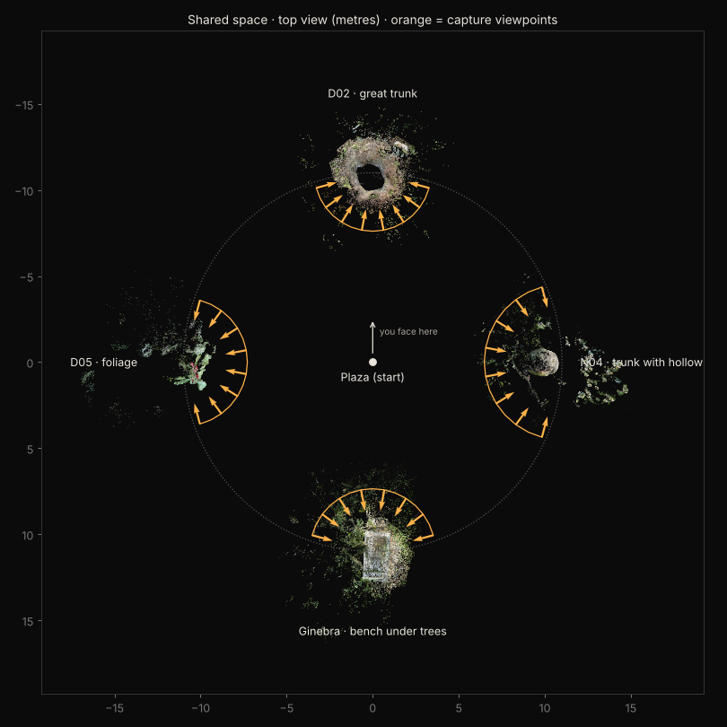

# Viewcone Erosion — Experiment 1 (WebXR · Meta Quest 3)

Four captured places share one dark space. Each stays photographic where its
camera stood and erodes into drifting motes wherever you view it from a place
nobody photographed it from. Walking is the interaction: step off a capture
path and the place forgets itself; step back and it re-forms; keep walking and
you reach the next one.



Built with **XR Blocks 0.24** (scene, XR session, desktop simulator), **Spark
2.4** (Gaussian-splat rendering, per-splat GPU modifier) and **three.js r186**.

---

## Run it

Requires Node 20+.

```bash
npm install
npm run dev          # https://<your-computer-ip>:5173  (self-signed HTTPS)
```

**On the Quest 3** (same Wi-Fi as your computer):

1. Open Meta Quest Browser → `https://<your-computer-ip>:5173`.
2. Accept the certificate warning (Advanced → Proceed). WebXR needs HTTPS.
3. Press **Enter XR**.

Alternatives to the LAN certificate:

- USB: `adb reverse tcp:5173 tcp:5173`, then open `https://localhost:5173` on the headset.
- Static hosting: `npm run build` and upload `dist/` to any HTTPS host
  (GitHub Pages, Netlify, Vercel, Cloudflare Pages). A prebuilt `dist/` is
  included in this folder.

### Meta Quest 2

The app detects the headset from Quest Browser's user agent and picks a
performance profile; force one with `?profile=quest2`, `quest3` or `desktop`.

| Setting | Quest 2 | Quest 3 |
| --- | --- | --- |
| Places loaded | Lighter cuts in `public/scenes/q2/`: 206k splats total (D02 100k, N04 60k, Ginebra 35k, D05 11k) | Full cuts: 397k |
| Render resolution | 0.8 × the headset's recommended size | 1.0 × |
| Fixed foveation | Maximum (1) | 0.5 |
| Splat footprint | 2 standard deviations, at most 96 px radius | √5 deviations, 256 px |
| Faint splats skipped | Below 4/255 opacity | Below 2/255 |
| Erosion updated every frame | Places within 9 m | Within 16 m |
| Farther places updated | Every 12th frame | Every 6th frame |
| Capture cameras checked per splat | 5 nearest | 8 nearest |

Quest 2 has roughly half the GPU of a Quest 3, and splats are limited by fill
rate (how many overlapping pixels get drawn), so the biggest wins are fewer
splats, a lower resolution and a cap on huge splats close to your face. If it
still stutters, try `?profile=quest2&near=6` first, then lower the counts with
`tools/prepare_scene.py --max-points`.

**On a desktop** the same URL opens the XR Blocks simulator (WASD + right-drag).

## The shared space

The four captures from
[expanded-interface/PLY_Files](https://github.com/expanded-interface/PLY_Files)
stand on a ring (radius 11 m) around a central plaza, clockwise from straight
ahead: D02, N04, Ginebra, D05. Each is turned so its photographed side, and its
arc of capture viewpoints, faces the plaza. From the centre you see every place
from where it was photographed; walk around behind one and it erodes.

- **Walk** (room scale or left stick) from one place to another. Entering a
  place shows its name for a few seconds.
- **Stops.** Trigger or pinch dissolves the whole space, moves you, and
  re-forms it with you standing at the next stop, facing where you were
  already looking: plaza → D02 → N04 → Ginebra → D05 → plaza.
- A faint dust of points marks the floor everywhere, so the void has a ground.
- Places closer than 16 m update their erosion every frame; farther ones every
  6th frame, which keeps all four within Quest's budget (397k splats total).

| Place | Content | Splats | Cut |
| --- | --- | --- | --- |
| `D02` | Great trunk with moss and roots | 220k | 5.5 m radius, subsampled from 308k |
| `N04` | Trunk with a hollow, foliage around | 114k | 6 m radius |
| `Ginebra` | Stone bench under trees | 52k | 6.5 m radius |
| `D05` | Foliage | 11k | 6.5 m radius, centre set by hand |

To change the arrangement, edit `layout.radius` and the order of `scenes` in
`public/scenes/scenes.json`; `?ring=14` overrides the radius from the URL.

The source files are plain coloured point clouds (x, y, z, RGB, Y up), with no
splat attributes and no camera poses. `tools/prepare_scene.py` converts them:

- **Surfels.** Each point becomes a flat Gaussian disc lying in its local
  surface (PCA normal of its 12 neighbours), sized by local point spacing, so
  bark and stone read as surfaces up close. Isolated points stay as faint
  atmosphere (22% opacity).
- **Authored capture viewpoints.** Since there are no poses, the script finds
  the main subject (densest vertical structure), the ground, and the side with
  the most surface detail, then places 15 virtual cameras along a 150° arc at
  1.6 m eye height, about 2 m from the subject, aimed at it. You start at the
  middle one. If you have the real poses for these captures (COLMAP
  `images.txt` or `cameras.json`), load them instead: the piece is about where
  the photographer actually stood.

- **Cut to a place.** Each cloud is cropped to a soft-edged cylinder around its
  subject (opacity fades over the last 1.5 m), so the places do not spill into
  each other. The script prints an `anchor` (subject centre on the ground, and
  the middle viewpoint) that `scenes.json` uses to place it on the ring.

```bash
python3 tools/prepare_scene.py path/to/cloud.ply public/scenes MYID --keep 6 \
  [--max-points 220000] [--center x,z] [--ground y] [--arc 150] [--count 15]
```

Then add an entry with its `anchor` to `public/scenes/scenes.json`.

## What you see first

You start in the plaza facing D02, 11 m away: its bark is photographic because
you are looking from its capture side. Walk toward it, then around it: the far
side and the upper trunk were never photographed and are mostly residue. Turn
around: N04 is to your right, Ginebra behind you, D05 to your left.

## Controls

| Input | Action |
| --- | --- |
| Walk (room scale) | The primary interaction |
| Desktop: WASD, right-drag | Walk / look (XR Blocks simulator) |
| Right trigger / right-hand pinch | Next stop (dissolve, move, re-form) |
| Left trigger / left-hand pinch | Previous stop |
| Left stick | Move, head-relative |
| Right stick ← → | Snap turn 30° |
| Right stick ↑ ↓ | Move up / down |
| A / X | Show capture cameras (orange lines: position + view direction) |
| B / Y | Debug colours: blue = observed, amber = eroding |
| Desktop: N / P or ← → | Next / previous stop |
| Desktop: C / V | Same as A/X and B/Y |

## Use your own capture

Add it to the space: run `tools/prepare_scene.py` (point clouds) or copy a
trained splat and its cameras into `public/scenes/`, then add an entry with an
`anchor` to `public/scenes/scenes.json`. Places are spread evenly around the
ring in list order.

Camera formats:

| Trainer / tool | File to give | Notes |
| --- | --- | --- |
| Inria 3DGS trainer | `cameras.json` (in the output folder) | Same frame as `point_cloud.ply` |
| COLMAP | `images.txt` (+ `cameras.txt` for field of view) | Convert binary models: `colmap model_converter --input_path sparse/0 --output_path sparse_txt --output_type TXT` |
| Trainers that re-centre or rescale the scene (e.g. Nerfstudio) | COLMAP files plus that tool's transform | The splat and cameras must share one frame. Press A/X: the orange lines should sit where you stood. |

**Splat budget on Quest 3:** about 400k–500k across all places. The modifier
regenerates nearby places every frame, so this is below Spark's own ~1M
guidance for static scenes. Reduce first: lower the trainer's splat cap, or use GSOPs Reduce in Houdini.

## Parameters (URL)

| Param | Default | Meaning |
| --- | --- | --- |
| `a0` | 12 | Degrees off a capture ray below which matter is fully intact |
| `a1` | 50 | Degrees above which matter is fully eroded |
| `haze` | 0.7 | Erosion level (0–1) where motes start thinning out |
| `residue` | 0.3 | Opacity left when fully eroded (0 = vanish) |
| `mote` | 0.008 | Mote radius in metres |
| `amp` | 0.06 | Drift amplitude in metres when fully eroded |
| `freq` | 3 | Drift field frequency (1/m) |
| `loop` | 12 | Drift loop in seconds; motion repeats exactly |
| `mode` | `vr` | `ar` = passthrough: the memory floats in your room |
| `flip` | 1 | Rotate COLMAP y-down to y-up (set 0 if upside down) |
| `rotY` | 0 | Extra yaw of the capture, degrees |
| `speed` | 1.4 | Stick locomotion, m/s |
| `debug` | 0 | `1` = start in debug colours |
| `profile` | auto | `quest2`, `quest3` or `desktop` (see Meta Quest 2) |
| `ring` | 11 | Ring radius in metres |
| `near` | 9 / 16 | Places closer than this (m) update every frame (Quest 2 / others) |
| `leave`, `arrive` | 1.2, 2.6 | Stop transition seconds: dissolve / re-form |

URL values apply to every place and override `scenes.json`.
Example: `?ring=14&a0=8&a1=35&residue=0.15`

## How it works

`src/viewcone.js` injects a Spark **world modifier** (a dyno GLSL block) that
runs per splat on the GPU each frame:

1. Choose the 8 capture cameras nearest your head (CPU), pass them as uniforms.
2. For each splat: among those cameras whose view cone contains the splat,
   find the smallest angle between *splat→head* and *splat→camera*.
3. `e = smoothstep(a0, a1, angle)`; as `e` rises the splat's covariance
   collapses to an isotropic mote, it drifts on a loop-safe field (time enters
   only through cos/sin of a phase), and its opacity falls to `residue`.

Each place has its own uniforms, so its own cameras and erosion settings.
`src/cameras.js` parses `cameras.json` and COLMAP text models into the
splat's local frame. `src/main.js` is the XR Blocks script: ring layout,
locomotion, stops, update throttling, gizmos.

## Known limitations

- **No occlusion test.** A camera "observes" every splat inside its view cone,
  even one behind a wall. Fine for open scenes; for rooms, precompute per-splat
  visibility offline (depth test against each training view) and store it as a
  per-splat attribute.
- **Cone, not frustum.** The rectangular image frustum is approximated by a
  cone using the larger half field of view, so image corners count as seen.
- **8 nearest cameras.** For each splat the best-angle camera is almost always
  among those nearest your head, but not always; long thin captures can show
  small seams. Raise `MAX_CAMS` in `viewcone.js` (cost is linear).
- **XR Blocks on Quest.** XR Blocks officially targets Chrome on Android XR and
  the desktop simulator. Quest Browser is Chromium-based, so the core path used
  here (three.js render loop, WebXR session, controllers) should behave the
  same, but its Android XR extras (depth, some gestures, AI features) are not
  used here and are not guaranteed on Quest.
- **Not yet tested on a headset.** Verified in desktop Chrome through the XR
  Blocks simulator. Check frame rate in the headset with the Quest Browser
  performance overlay or remote DevTools.
- Antialiasing is off on purpose: Quest Browser has a reported hang combining
  MSAA, per-frame shadow passes and Spark's GPU readbacks.

## Files

```
index.html            panel + entry
src/main.js           XR Blocks script: load, place, locomotion, input
src/viewcone.js       Spark dyno modifier (the erosion)
src/cameras.js        cameras.json / COLMAP parsers, virtual capture arc
src/style.css         panel styling
public/scenes/        D02, N04, Ginebra, D05 (cut, surfel splats) + authored cameras; scenes.json (layout + anchors)
public/scenes/q2/     lighter cuts of the same places for the Quest 2 profile
docs/layout.png       top view of the shared space
public/demo/          bundled procedural test capture (150k splats, 13 cameras)
tools/prepare_scene.py     point cloud -> surfel splats + authored cameras
public/sim/void.json  empty desktop-simulator environment for VR mode
tools/make_demo_scene.py   regenerates the demo capture
dist/                 prebuilt static site
```
